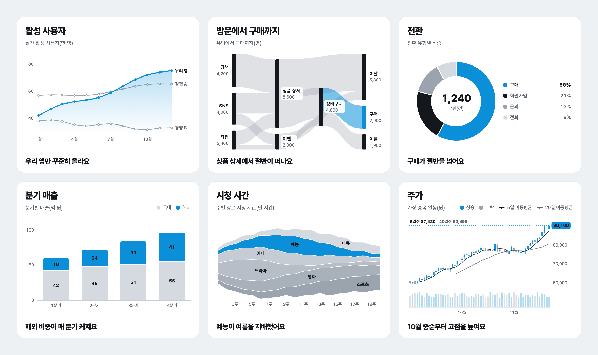
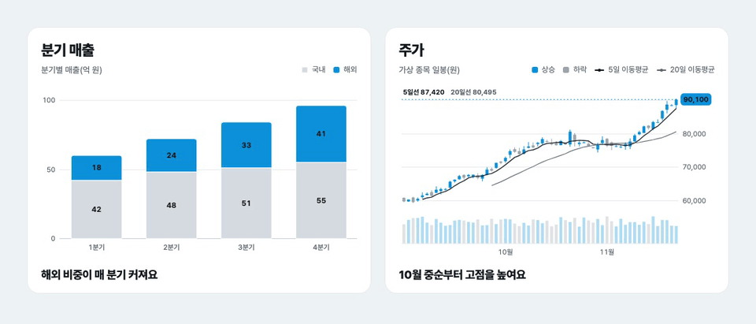
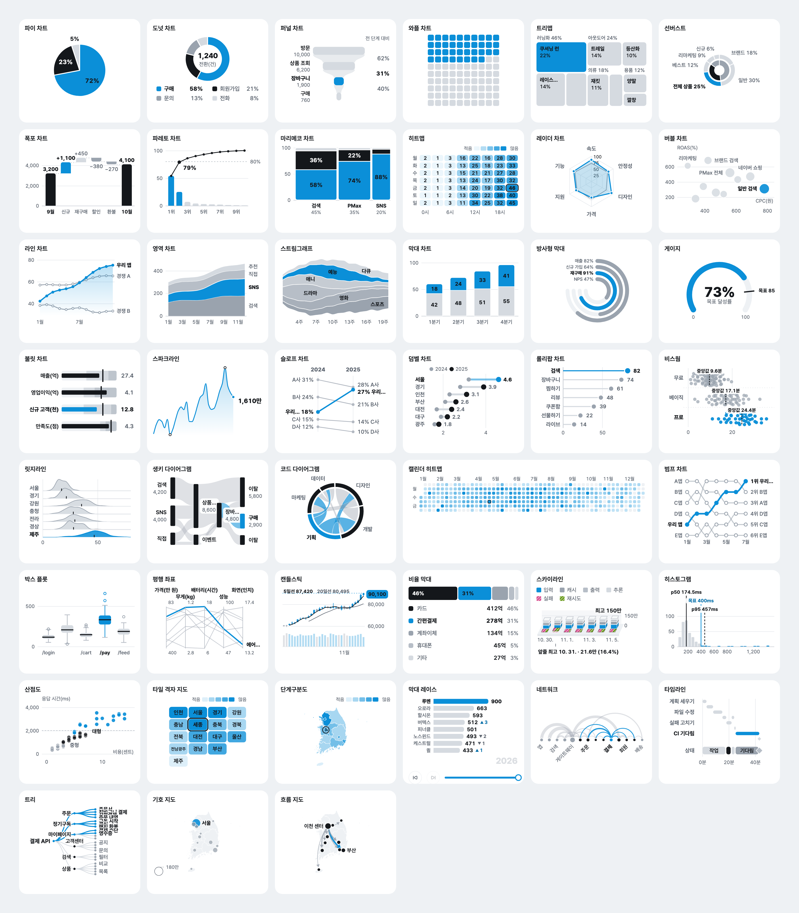

<p align="center">
  <picture>
    <source media="(prefers-color-scheme: dark)" srcset="docs/readme/logo-dark.svg">
    
  </picture>
</p>

<h1 align="center">ztd charts</h1>

<p align="center">
  보고서처럼 읽히는 React 애니메이션 차트예요.<br>
  순수 SVG 차트 36종, 런타임 의존성 0, AI 에이전트가 바로 쓰는 JSON 스펙.
</p>

<p align="center">
  <a href="https://www.npmjs.com/package/ztd-charts"></a>
  <a href="LICENSE"></a>
  
</p>

<p align="center">
  <a href="https://charts.ztd.app/docs/docs/?lang=ko"><b>문서</b></a> ·
  <a href="https://charts.ztd.app/docs/?lang=ko">갤러리</a> ·
  <a href="https://charts.ztd.app/docs/examples/?lang=ko">예시 대시보드</a> ·
  <a href="https://charts.ztd.app/docs/playground/?lang=ko">플레이그라운드</a> ·
  <a href="README.md">English</a>
</p>

<p align="center">
  
</p>

## 왜 ztd charts 인가요

- **카드 하나가 한 가지를 말해요.** 강조할 항목 하나만 강조색이고 나머지는 무채색이에요. 차트 아래 굵은 한 줄 요약이 있어서, 축을 읽기 전에 요점이 먼저 보여요.
- **움직임이 설명을 도와요.** 화면에 들어오면 그려지고, 데이터가 바뀌면 지금 자리에서 이어서 움직여요. 구간을 끌면 그 사이의 등락과 최고, 최저가 보여요.
- **접근성이 기본이에요.** 키보드 탐색, 차트마다 스크린 리더 설명과 데이터 표, 동작 줄이기를 지원하고, 모든 글자가 WCAG AA 대비를 넘어요.
- **가볍고, 더 설치할 게 없어요.** 필요한 건 React 하나예요. 공통 코어를 포함해 차트 하나가 약 12~25 kB(Brotli)이고, 데이터가 아주 많으면 알아서 캔버스로 그려요.
- **AI가 바로 써요.** 모든 차트를 공개 JSON Schema 가 있는 JSON 스펙으로도 쓸 수 있어요. CLI, MCP 서버, 에이전트 스킬이 스펙을 검사하고 PNG, SVG, HTML로 그려요.
- **영어와 한국어.** 기본은 en-US 예요. `locale="ko-KR"`이면 숫자 포맷(1.2만, 3.4억)과 차트 글자가 한국어로 바뀌어요.

<p align="center">
  
</p>

## 빠른 시작

```bash
npm i ztd-charts
```

```tsx
import { ChartCard, PieChart, ThemeProvider } from "ztd-charts";

const sales = [
  { device: "모바일", share: 72 },
  { device: "PC", share: 23 },
  { device: "태블릿", share: 5 },
];

export function SalesByDevice() {
  return (
    <ThemeProvider locale="ko-KR">
      <ChartCard
        title="기기별 매출"
        subtitle="매출 비중(%)"
        legend={[{ label: "모바일", color: "accent" }, { label: "PC", color: "ink" }, { label: "태블릿", color: "neutral" }]}
        takeaway="매출 대부분이 모바일에서 나와요"
      >
        <PieChart data={sales} label="device" value="share" highlight="모바일" />
      </ChartCard>
    </ThemeProvider>
  );
}
```

같은 차트를 JSON 스펙으로 쓰면 이래요. CLI, MCP 서버, AI 에이전트는 이 스펙으로 일해요.

```tsx
import { Chart } from "ztd-charts";

<Chart
  spec={{
    type: "pie",
    data: sales,
    encoding: { label: "device", value: "share" },
    options: { highlight: "모바일", locale: "ko-KR" },
  }}
/>;
```

## 차트 36종

<a href="https://charts.ztd.app/docs/?lang=ko"></a>

| 묶음 | 차트 |
|---|---|
| 비율 | 파이 · 도넛 · 와플 · 마리메코 · 비율 막대 |
| 계층 | 트리맵 · 선버스트 |
| 흐름 | 퍼널 · 생키 · 코드 다이어그램 |
| 비교 | 막대 · 폭포 · 파레토 · 레이더 · 슬로프 · 덤벨 · 롤리팝 |
| 추이 | 라인(범위 띠 포함) · 영역 · 스트림그래프 · 스파크라인 · 캘린더 히트맵 · 범프 · 캔들스틱 · 스카이라인 |
| 분포 | 박스 플롯(바이올린 포함) · 비스웜 · 릿지라인 · 히스토그램 |
| 관계 | 히트맵 · 버블 · 산점도 · 평행 좌표 |
| KPI | 게이지 · 불릿 · 방사형 막대 |

차트마다 바로 만져 보는 예시, 프롭, 복사할 코드가 있는 페이지가 [갤러리](https://charts.ztd.app/docs/?lang=ko)에 있어요. 왜 이 차트들을 골랐고 무엇을 뺐는지는 [차트 카탈로그](docs/catalog.ko.md)에 있어요.

## AI와 함께 쓰기

```bash
# Claude Code 에 MCP 서버 붙이기 (Cursor, Claude Desktop 은 가이드에 있어요)
claude mcp add ztd-charts -- npx -y ztd-charts-mcp

# 데이터에 맞는 차트 추천과 바로 쓰는 스펙, 그다음 PNG
npx ztd-charts-cli suggest sales.csv --out-dir charts --locale ko
npx ztd-charts-cli render donut.json --out donut.png --theme light --scale 2 --locale ko
```

MCP 서버는 차트 목록을 보여 주고, 차트별 스키마와 예시를 돌려주고, 스펙을 검사해 틀린 필드에 고칠 이름을 제안하고, PNG, SVG, React 코드로 그리고, CSV나 행, URL에서 차트를 추천해요. [에이전트 스킬](skills/ztd-charts/SKILL.md)은 차트 고르기부터 검사한 미리보기까지 순서를 알려 주고, [llms.txt](llms.txt)는 라이브러리 전체를 파일 하나로 모델에게 건네요.

## 패키지

| 패키지 | 하는 일 |
|---|---|
| [`ztd-charts`](https://www.npmjs.com/package/ztd-charts) | React 차트, 카드, 그리드, 테마, 데이터 훅, 그리고 스펙 도구(`ztd-charts/spec`)와 서버 렌더링(`ztd-charts/server`) |
| [`ztd-charts-cli`](https://www.npmjs.com/package/ztd-charts-cli) | 터미널에서 목록 보기, 검사, 그리기, 프로젝트 시작, 차트 추천 |
| [`ztd-charts-mcp`](https://www.npmjs.com/package/ztd-charts-mcp) | AI 에이전트용 차트 도구 다섯 개가 있는 MCP 서버 |

## 더 보기

- [가이드](docs/guide.ko.md): 공통 프롭, 카드와 그리드, 테마 토큰, 애니메이션과 인터랙션, 접근성, 데이터 연결(REST, CSV, Supabase, Google Sheets, Postgres), JSON 스펙, CLI, MCP 서버, 개발
- [문서 사이트](https://charts.ztd.app/docs/docs/?lang=ko): 차트마다 바로 만져 보는 예시, 예시 대시보드 5개, 데이터 연결, 플레이그라운드
- [QA 보고서](docs/QA-report.md): 스크린샷, 대비, 프레임, 1만 점 스트레스 시험, 번들 크기
- `@junhanlee/chart-kit`에서 옮겨 오나요? [옮기기](docs/guide.ko.md#junhanleechart-kit-에서-옮기기)를 보세요.

## 라이선스

MIT. 예시의 숫자는 모두 지어낸 값이에요.
