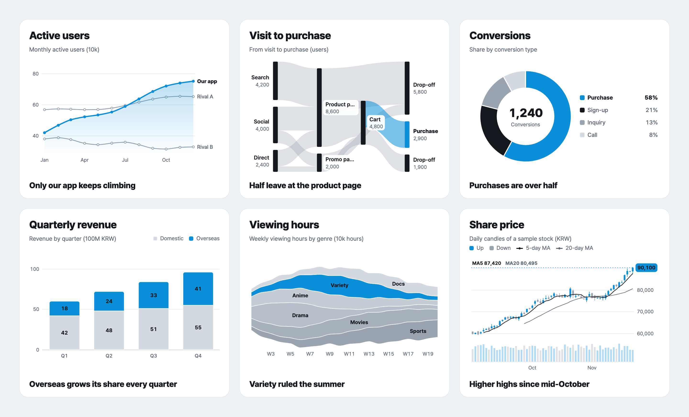
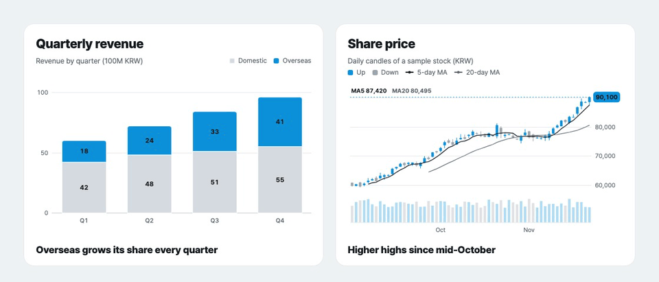
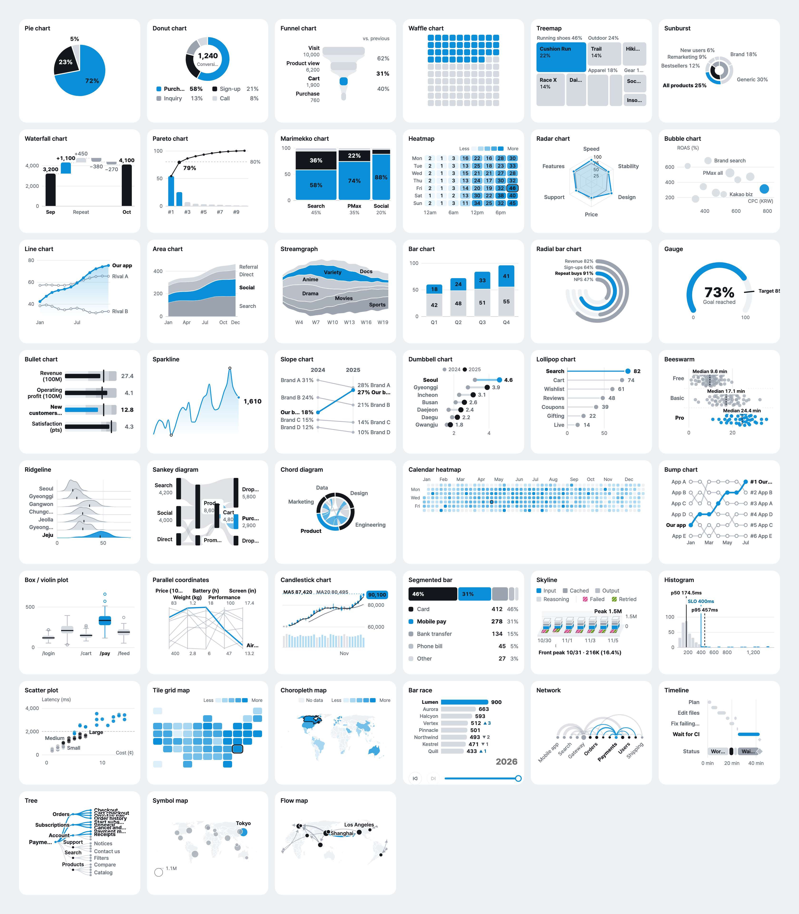

<p align="center">
  <picture>
    <source media="(prefers-color-scheme: dark)" srcset="docs/readme/logo-dark.svg">
    
  </picture>
</p>

<h1 align="center">ztd charts</h1>

<p align="center">
  Animated, accessible React charts that read like a report.<br>
  36 charts in pure SVG with no runtime dependencies, and a JSON spec your AI agent can write.
</p>

<p align="center">
  <a href="https://www.npmjs.com/package/ztd-charts"></a>
  <a href="LICENSE"></a>
  
</p>

<p align="center">
  <a href="https://charts.ztd.app/docs/docs/"><b>Docs</b></a> ·
  <a href="https://charts.ztd.app/docs/">Gallery</a> ·
  <a href="https://charts.ztd.app/docs/examples/">Example dashboards</a> ·
  <a href="https://charts.ztd.app/docs/playground/">Playground</a> ·
  <a href="README.ko.md">한국어</a>
</p>

<p align="center">
  
</p>

## Why ztd charts

- **Each card says one thing.** One item takes the accent color and the rest stay neutral, with a bold takeaway under the chart, so a reader sees the point before reading the axes.
- **Motion that explains.** Charts draw in as they scroll into view, move on from where they are when the data changes, and let you drag over a range to read its change, high and low.
- **Accessible by default.** Keyboard navigation, a screen reader description and data table for every chart, reduced motion, and every label at WCAG AA contrast.
- **Small, with nothing else to install.** React is the only peer dependency. A chart with the shared core is about 12 to 25 kB Brotli, and very large data switches to canvas on its own.
- **Ready for AI.** Every chart is also a JSON spec with a public JSON Schema, and a CLI, an MCP server and an agent skill validate it and render it to PNG, SVG or HTML.
- **English and Korean.** en-US by default. `locale="ko-KR"` switches number formats (1.2만, 3.4억) and chart text to Korean.

<p align="center">
  
</p>

## Quick start

```bash
npm i ztd-charts
```

```tsx
import { ChartCard, PieChart } from "ztd-charts";

const sales = [
  { device: "Mobile", share: 72 },
  { device: "Desktop", share: 23 },
  { device: "Tablet", share: 5 },
];

export function SalesByDevice() {
  return (
    <ChartCard
      title="Sales by device"
      subtitle="Share of revenue (%)"
      legend={[{ label: "Mobile", color: "accent" }, { label: "Desktop", color: "ink" }, { label: "Tablet", color: "neutral" }]}
      takeaway="Mobile brings in most sales"
    >
      <PieChart data={sales} label="device" value="share" highlight="Mobile" />
    </ChartCard>
  );
}
```

The same chart as a JSON spec, which is what the CLI, the MCP server and an AI agent work with:

```tsx
import { Chart } from "ztd-charts";

<Chart
  spec={{
    type: "pie",
    data: sales,
    encoding: { label: "device", value: "share" },
    options: { highlight: "Mobile" },
  }}
/>;
```

## 36 charts

<a href="https://charts.ztd.app/docs/"></a>

| Group | Charts |
|---|---|
| Proportion | Pie · Donut · Waffle · Marimekko · Segmented bar |
| Hierarchy | Treemap · Sunburst |
| Flow | Funnel · Sankey · Chord |
| Comparison | Bar · Waterfall · Pareto · Radar · Slope · Dumbbell · Lollipop |
| Trend | Line (range band too) · Area · Streamgraph · Sparkline · Calendar heatmap · Bump · Candlestick · Skyline |
| Distribution | Box plot (violin too) · Beeswarm · Ridgeline · Histogram |
| Relationship | Heatmap · Bubble · Scatter · Parallel coordinates |
| KPI | Gauge · Bullet · Radial bar |

Each chart has a page with a live demo, its props and copyable code in the [gallery](https://charts.ztd.app/docs/). Why each one made the cut, and what was left out, is in the [chart catalog](docs/catalog.md).

## Use it with AI

```bash
# Add the MCP server to Claude Code (Cursor and Claude Desktop are in the guide)
claude mcp add ztd-charts -- npx -y ztd-charts-mcp

# Chart ideas and ready specs from your data, then a PNG
npx ztd-charts-cli suggest sales.csv --out-dir charts
npx ztd-charts-cli render donut.json --out donut.png --theme light --scale 2
```

The MCP server lists charts, returns a chart's schema and example, validates a spec with suggestions for wrong fields, renders it to PNG, SVG and React code, and suggests charts from CSV, rows or a URL. The [agent skill](skills/ztd-charts/SKILL.md) walks an agent from picking a chart to a checked preview, and [llms.txt](llms.txt) gives a model the whole library in one file.

## Packages

| Package | What it is |
|---|---|
| [`ztd-charts`](https://www.npmjs.com/package/ztd-charts) | The React charts, cards, grid, themes and data hooks, plus spec tools (`ztd-charts/spec`) and server rendering (`ztd-charts/server`) |
| [`ztd-charts-cli`](https://www.npmjs.com/package/ztd-charts-cli) | List, validate, render, start a project and suggest charts from the terminal |
| [`ztd-charts-mcp`](https://www.npmjs.com/package/ztd-charts-mcp) | An MCP server with five chart tools for AI agents |

## Learn more

- [Guide](docs/guide.md): common props, cards and grid, theme tokens, animation and interaction, accessibility, connecting data (REST, CSV, Supabase, Google Sheets, Postgres), the JSON spec, the CLI, the MCP server and development
- [Docs site](https://charts.ztd.app/docs/docs/): every chart with a live demo, five example dashboards, data connection and a playground
- [QA report](docs/QA-report.md): screenshots, contrast, frame rate, a 10,000-point stress test and bundle sizes
- Coming from `@junhanlee/chart-kit`? See [Migrating](docs/guide.md#migrating-from-junhanleechart-kit).

## License

MIT. Every number in the examples is made up.
