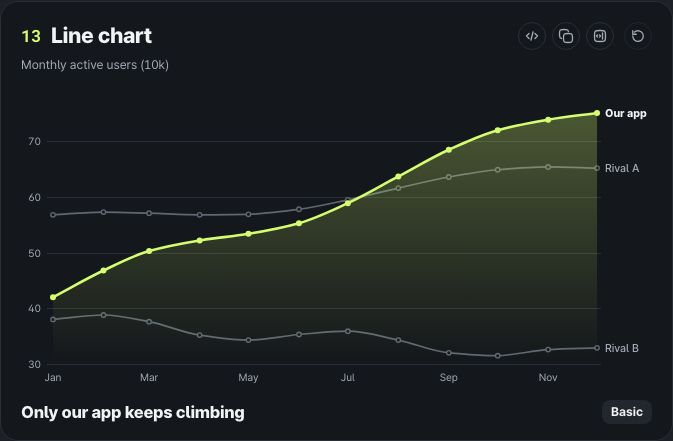
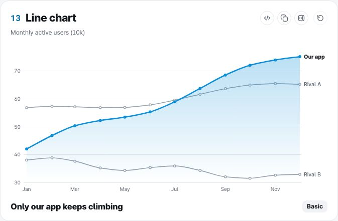
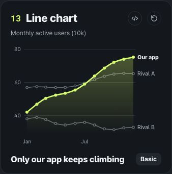

# ztd charts final report

> **Old record.** Written on 2026-10-29 and not updated since. Chart types, packages and features have grown since then. For the current state, see the [README](../README.md) and the [QA report](QA-report.md).

## What we built

We built 31 animated charts for React. They are pure SVG (canvas when there are many points) and have no runtime dependencies. You can draw each one from a single JSON spec, and a CLI, an MCP server and an agent skill come with them. The project also includes a card (ChartCard), a grid, dark and light themes, and a Korean documentation site (a gallery and 5 example dashboards).

| Group | Charts |
|---|---|
| Proportion | Pie, donut, waffle, Marimekko |
| Hierarchy | Treemap, sunburst |
| Flow | Funnel, Sankey, chord |
| Comparison | Bar, waterfall, Pareto, radar, slope, dumbbell, lollipop |
| Trend | Line, area, stream, sparkline, calendar, bump |
| Distribution | Box (violin), beeswarm, ridgeline |
| Relationship | Heatmap, bubble (scatter), parallel coordinates |
| KPI | Gauge, bullet, radial bar |

## Screenshots

Card screenshots for each chart are in [docs/screens/charts/](screens/charts/) (`{theme}-{width}/{type}.jpg`). We do not put screenshots of the examples and pages in the public repository.

| Line, dark, 1440 | Line, light, 1440 | Line, dark, 390 |
|---|---|---|
|  |  |  |

## QA numbers

We measured with `qa/run-all.sh` on a production build (`vite build` + `vite preview`), headless Chromium 156 and an Apple M3 (8 cores).

| Item | Result |
|---|---|
| Unit tests (Vitest) | 201/201 pass (ztd-charts 180, CLI 12, MCP 9) |
| Type check, lint | 0 errors in 4 projects, ESLint 0 errors and 0 warnings |
| Bundle size (gzip) | 10.4 to 16 KB for one chart, 67.8 KB for the full bundle, size-limit passes |
| Screenshots, layout | 238 screenshots, and 0 clipping, overlap, intrusion or horizontal overflow across 484 cards |
| Text contrast | 0 of 10,308 text elements below the threshold, minimum 4.6:1 |
| Accessibility | 0 axe violations (6 pages × 2 themes), interaction checks 12/12 |
| Animation (31 charts) | 60fps at both 1× and 4× CPU |
| Replay all in the gallery (4× CPU) | 2 columns 59.5fps, 3 columns 60fps, 0 long tasks |
| 10,000-point stress (11 charts, 1×) | First render up to 63ms, replay 60fps, hover p95 up to 8ms |
| 10,000-point stress (11 charts, 4×) | First render up to 221ms (parallel coordinates), calendar 201ms, stream 115ms |
| Visual regression | 62/62 pass against a baseline made on the same macOS. 58 fail against the committed Linux baseline (text antialiasing differences) |

What we checked and fixed this time:

- The tooltip of the rightmost bubble stays inside the card in the production build at 1440, 1280 and 390 (25px right margin). Nothing needed fixing, and we added it to the QA checks.
- "Bad URL" on `/data` shows an error card in the production build, and retrying loads it again. We added this to the QA checks too.
- Charts measured their width twice when they mounted. We cut that to once (all charts). For the calendar, we also cut the work for the cell index and month labels. The calendar's 10,000-point first render at 4× went from 223ms to 201ms, and its longest task from 121ms to 99ms.
- The Sankey SVG snapshot differed only on Node 26 (a difference in the 14th decimal place). We fixed it by rounding coordinates.

## Not done

- **The 4× performance gap from the previous VM did not reproduce on this machine.** Before, the stream's 10,000-point replay ran at 34fps and the calendar's first render took 511ms. On the M3, the stream runs at 60fps at the same 4×, so we could not show the effect of a fix. The profile shows that most of the stream replay goes to building curve path strings. We did not round to integers or reduce points, because that changes the shape. On a slower machine, the numbers may be close to the earlier ones.
- **Some cases still fall short of 60fps at 4× CPU.** In the 10,000-point replay, bubble runs at 55.7fps and beeswarm at 52.6fps.
- **The visual regression baseline images are Linux only.** On macOS they fail because of font rendering differences. We need either a baseline per platform or comparisons only in Linux CI.
- **We did not measure on real devices, Safari or Firefox.** The numbers come from headless Chromium.
- **We did not publish to npm.** PNG export matches the baseline images only when Pretendard is installed, and the interactive HTML loads React from esm.sh.
