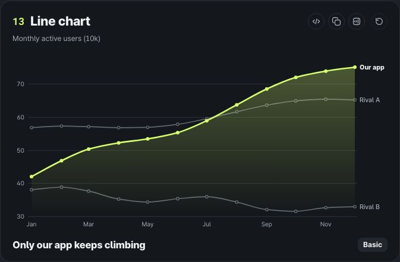
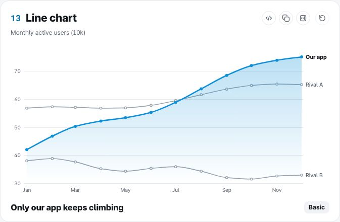
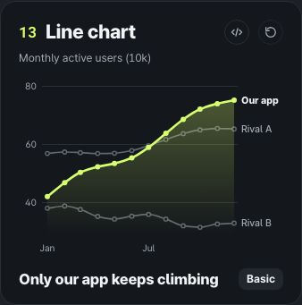

# QA 리포트

생성: 2026-11-06 13:38 UTC · 대상: 프로덕션 빌드(`vite build` + `vite preview`) · 브라우저: Chromium 156.0.8078.4 (Playwright headless shell)

이 리포트는 Playwright, Vitest, size-limit 으로 잰 숫자를 모은 거예요.

## 요약

| 항목 | 결과 | 기준 | 판정 |
|---|---|---|---|
| 스크린샷 | 250장 (차트 33종 × 3폭 × 2테마, 예시 5개 섹션 × 3폭 × 2테마, 페이지) | 1440, 1280, 390 / 다크, 라이트 | 통과 |
| 검사한 카드 | 522장 (갤러리 2칸, 3칸, 예시) | | |
| 글자 잘림 | 0건 | 0 | 통과 |
| 라벨 겹침 | 0건 | 0 | 통과 |
| 머리글, 꼬리말 침범 | 0건 | 0 | 통과 |
| svg 밖 도형 | 0개 | 0 | 통과 |
| 제목 말줄임 | 0건 | 0 | 통과 |
| 가로 넘침 (페이지) | 0건 | 0 | 통과 |
| 글자 대비 (SVG + HTML) | 10,502개 중 미달 0개, 최소 4.6:1 | WCAG AA 4.5:1 (큰 글자 3:1) | 통과 |
| 애니메이션 fps (차트 33종, 1× CPU) | 가장 낮은 60 fps, long task 0건 | 60 fps, 50ms 넘는 작업 0 | 통과 |
| 애니메이션 fps (4× CPU 감속) | 가장 낮은 60 fps | 참고용 (중급 모바일 근사) | - |
| 1만 점 스트레스 (11종) | 첫 화면 최대 334.1ms, 재생 최저 60 fps, 호버 p95 최대 5.9ms | | 표 참고 |
| 번들 크기 (차트 하나, Brotli) | 11.4~19.2 KB, 전체 80.6 KB | size-limit 예산 | 통과 |
| 단위 테스트 (Vitest) | 368/368 통과 | 전부 | 통과 |
| 타입 검사 | 5개 프로젝트 | 오류 0 | 통과 |
| 린트 (ESLint) | 오류 0, 경고 0 | 오류 0 | 통과 |
| 접근성 (axe, 6페이지 × 2테마) | 위반 노드 0개 | 0 | 통과 |
| 키보드, 동작 줄이기, 툴팁, 오류 상태 | 12/12 | 전부 | 통과 |
| 시각 회귀 (33종 × 2테마) | 66장 비교, 실패 0 (기준 이미지와 플랫폼이 다르면 10장 참고) | 픽셀 차이 0.3% 이하 | 통과 |

## 1. 환경과 방법

- 기기: 14 vCPU (Apple M4 Pro), RAM 48 GB, Node v26.7.0, Chromium 156.0.8078.4
- 화면: 1440×900, 1280×900, 390×900. 스크린샷과 레이아웃 검사는 `prefers-reduced-motion: reduce`로 최종 상태를 바로 그려요(애니메이션 끝 상태와 같은 그림).
- **잘림**: 카드 안쪽(테두리 1px) 밖으로 1.5px 넘게 나간 글자. **겹침**: 같은 차트 SVG 글자끼리 글리프 상자(세로 70%)가 4px² 넘게, 작은 쪽 면적의 8% 넘게 겹친 경우. **침범**: 차트 글자가 카드 머리글이나 꼬리말 영역에 들어간 경우.
- **대비**: 글자만 투명하게 만든 카드 스크린샷에서 글자 상자 안 배경 픽셀을 모아, 15% 넘게 차지하는 배경색 각각과 실제 글자색(조상 opacity까지 곱한 값)을 합성해 WCAG 대비를 계산하고 가장 나쁜 값을 써요. 그래서 도형 위 라벨, 반투명 면 위 라벨도 실제 화면 그대로 재요.
- **성능**: 페이지에 requestAnimationFrame 기록기를 심고 `longtask`, `long-animation-frame` 관찰자를 붙여, 다시 재생 버튼을 누른 뒤 1.6초 동안 프레임 간격을 재요. 떨어진 프레임은 25ms 넘는 간격. 4× CPU는 CDP `Emulation.setCPUThrottlingRate`.
- **호버 지연**: pointermove를 보낸 뒤 차트 DOM이 처음 바뀔 때까지(툴팁, 강조). 40번 측정한 p50, p95.

## 2. 스크린샷

갤러리 카드 33종을 찍은 198장은 `docs/screens/charts/{테마}-{폭}/{type}.jpg` 에 있어요 (JPEG 80%). 예시 섹션과 페이지 화면은 공개 저장소에 넣지 않아요.

| 라인 다크 1440 | 라인 라이트 1440 | 라인 다크 390 |
|---|---|---|
|  |  |  |

## 3. 레이아웃

| 화면 | 카드 | 잘림 | 겹침 | 침범 | svg 밖 | 제목 말줄임 |
|---|---|---|---|---|---|---|
| gallery 1440 dark | 33 | 0 | 0 | 0 | 0 | 0 |
| gallery-3col 1440 dark | 33 | 0 | 0 | 0 | 0 | 0 |
| examples 1440 dark | 32 | 0 | 0 | 0 | 0 | 0 |
| gallery 1440 light | 33 | 0 | 0 | 0 | 0 | 0 |
| gallery-3col 1440 light | 33 | 0 | 0 | 0 | 0 | 0 |
| examples 1440 light | 32 | 0 | 0 | 0 | 0 | 0 |
| gallery 1280 dark | 33 | 0 | 0 | 0 | 0 | 0 |
| gallery-3col 1280 dark | 33 | 0 | 0 | 0 | 0 | 0 |
| examples 1280 dark | 32 | 0 | 0 | 0 | 0 | 0 |
| gallery 1280 light | 33 | 0 | 0 | 0 | 0 | 0 |
| gallery-3col 1280 light | 33 | 0 | 0 | 0 | 0 | 0 |
| examples 1280 light | 32 | 0 | 0 | 0 | 0 | 0 |
| gallery 390 dark | 33 | 0 | 0 | 0 | 0 | 0 |
| examples 390 dark | 32 | 0 | 0 | 0 | 0 | 0 |
| gallery 390 light | 33 | 0 | 0 | 0 | 0 | 0 |
| examples 390 light | 32 | 0 | 0 | 0 | 0 | 0 |

## 4. 글자 대비

차트별 최소 대비 (갤러리, 모든 폭과 테마 중 가장 낮은 값):

| 차트 | 다크 최소 | 라이트 최소 | 검사한 글자 |
|---|---|---|---|
| 파이 | 7.8 | 5.1 | 66 |
| 도넛 | 7.8 | 5.6 | 90 |
| 퍼널 | 7.8 | 5.6 | 102 |
| 와플 | 7.8 | 4.8 | 60 |
| 트리맵 | 7.8 | 4.8 | 156 |
| 선버스트 | 5.1 | 4.8 | 78 |
| 폭포 | 7.8 | 4.8 | 128 |
| 파레토 | 7.8 | 4.8 | 132 |
| 마리메코 | 7.8 | 5.1 | 136 |
| 히트맵 | 4.6 | 4.8 | 468 |
| 레이더 | 7.8 | 4.8 | 102 |
| 버블 | 7.8 | 4.8 | 138 |
| 라인 | 7.8 | 5.6 | 102 |
| 영역 | 7.8 | 5.6 | 164 |
| 스트림 | 5.1 | 5.1 | 138 |
| 막대 | 7.8 | 5.1 | 144 |
| 방사형 막대 | 7.8 | 4.8 | 54 |
| 게이지 | 7.8 | 5.6 | 60 |
| 불릿 | 7.8 | 4.8 | 84 |
| 스파크라인 | 7.8 | 5.6 | 36 |
| 슬로프 | 7.8 | 4.8 | 102 |
| 덤벨 | 7.8 | 4.8 | 158 |
| 롤리팝 | 7.8 | 5.6 | 138 |
| 비스웜 | 7.8 | 5.6 | 98 |
| 릿지라인 | 7.8 | 5.6 | 110 |
| 생키 | 7.1 | 5.6 | 138 |
| 코드 | 7.8 | 5.6 | 60 |
| 캘린더 | 7.8 | 4.8 | 108 |
| 범프 | 7.8 | 4.8 | 144 |
| 박스 | 7.8 | 5.6 | 84 |
| 평행 좌표 | 7.8 | 5.6 | 126 |
| 캔들스틱 | 7.8 | 5.1 | 100 |
| 비율 막대 | 5.1 | 5.1 | 140 |

예시 대시보드 카드 192장의 최소 대비: 4.8:1.

## 5. 애니메이션 성능

기준선(아무 애니메이션 없음): 60 fps, 프레임 간격 p95 16.7ms. 헤드리스 Chromium이 60Hz로 그린다는 뜻이에요.

차트 페이지에서 다시 재생을 누른 뒤 1.6초 (차트 하나가 움직임):

| 차트 | fps 1× | p95 ms | 최대 ms | 떨어진 프레임 | long task | LoAF 최대 ms | fps 4× | p95 ms 4× | long task 4× |
|---|---|---|---|---|---|---|---|---|---|
| 파이 | 60 | 16.7 | 16.8 | 0 | 0 | 0 | 60 | 16.8 | 0 |
| 도넛 | 60 | 16.7 | 16.8 | 0 | 0 | 0 | 60.6 | 16.8 | 0 |
| 퍼널 | 60 | 16.8 | 16.8 | 0 | 0 | 0 | 60 | 16.7 | 0 |
| 와플 | 60 | 16.8 | 16.8 | 0 | 0 | 0 | 60 | 16.8 | 0 |
| 트리맵 | 60 | 16.7 | 16.8 | 0 | 0 | 0 | 60 | 16.7 | 0 |
| 선버스트 | 60 | 16.8 | 16.8 | 0 | 0 | 0 | 60 | 16.8 | 0 |
| 폭포 | 60 | 16.7 | 16.8 | 0 | 0 | 0 | 60 | 16.8 | 0 |
| 파레토 | 60 | 16.8 | 16.8 | 0 | 0 | 0 | 60 | 16.7 | 0 |
| 마리메코 | 60 | 16.8 | 16.8 | 0 | 0 | 0 | 60 | 16.7 | 0 |
| 히트맵 | 60 | 16.8 | 16.8 | 0 | 0 | 0 | 60 | 16.7 | 0 |
| 레이더 | 60 | 16.7 | 16.8 | 0 | 0 | 0 | 60 | 16.7 | 0 |
| 버블 | 60 | 16.8 | 16.8 | 0 | 0 | 0 | 60 | 16.7 | 0 |
| 라인 | 60 | 16.8 | 16.8 | 0 | 0 | 0 | 60 | 16.7 | 0 |
| 영역 | 60 | 16.8 | 16.8 | 0 | 0 | 0 | 60 | 16.7 | 0 |
| 스트림 | 60 | 16.8 | 16.8 | 0 | 0 | 0 | 60 | 16.7 | 0 |
| 막대 | 60 | 16.8 | 16.8 | 0 | 0 | 0 | 60 | 16.7 | 0 |
| 방사형 막대 | 60 | 16.7 | 16.8 | 0 | 0 | 0 | 60 | 16.8 | 0 |
| 게이지 | 60 | 16.7 | 16.8 | 0 | 0 | 0 | 60 | 16.7 | 0 |
| 불릿 | 60 | 16.8 | 16.8 | 0 | 0 | 0 | 60 | 16.8 | 0 |
| 스파크라인 | 60 | 16.7 | 16.8 | 0 | 0 | 0 | 60 | 16.7 | 0 |
| 슬로프 | 60 | 16.8 | 16.8 | 0 | 0 | 0 | 60 | 16.8 | 0 |
| 덤벨 | 60 | 16.7 | 16.8 | 0 | 0 | 0 | 60.6 | 16.7 | 0 |
| 롤리팝 | 60 | 16.7 | 16.8 | 0 | 0 | 0 | 60.6 | 16.7 | 0 |
| 비스웜 | 60 | 16.7 | 16.8 | 0 | 0 | 0 | 60.6 | 16.7 | 0 |
| 릿지라인 | 60 | 16.8 | 16.8 | 0 | 0 | 0 | 60 | 16.8 | 0 |
| 생키 | 60 | 16.8 | 16.8 | 0 | 0 | 0 | 60 | 16.7 | 0 |
| 코드 | 60 | 16.7 | 16.8 | 0 | 0 | 0 | 60 | 16.7 | 0 |
| 캘린더 | 60 | 16.7 | 16.8 | 0 | 0 | 0 | 60.6 | 16.8 | 0 |
| 범프 | 60 | 16.8 | 16.8 | 0 | 0 | 0 | 60 | 16.8 | 0 |
| 박스 | 60 | 16.7 | 16.8 | 0 | 0 | 0 | 60 | 16.8 | 0 |
| 평행 좌표 | 60 | 16.8 | 16.8 | 0 | 0 | 0 | 60.6 | 16.8 | 0 |
| 캔들스틱 | 60 | 16.8 | 16.8 | 0 | 0 | 0 | 60.6 | 16.7 | 0 |
| 비율 막대 | 60 | 16.7 | 16.8 | 0 | 0 | 0 | 60 | 16.7 | 0 |

여러 차트가 한꺼번에 움직일 때:

| 장면 | CPU | fps | p95 ms | 최대 ms | 떨어진 프레임 | long task |
|---|---|---|---|---|---|---|
| 갤러리 모두 다시 재생: 2칸, 보이는 차트 4개 | 1× | 60 | 16.8 | 16.8 | 0 | 0 |
| 갤러리 모두 다시 재생: 2칸, 보이는 차트 4개 | 4× | 60 | 16.7 | 16.8 | 0 | 0 |
| 갤러리 모두 다시 재생: 3칸, 보이는 차트 6개 | 1× | 60 | 16.7 | 16.8 | 0 | 0 |
| 갤러리 모두 다시 재생: 3칸, 보이는 차트 6개 | 4× | 60 | 16.7 | 16.8 | 0 | 0 |
| 예시 스크롤 등장: marketing | 1× | 59.4 | 16.7 | 33.2 | 1 | 0 |
| 예시 스크롤 등장: portfolio | 1× | 60 | 16.8 | 16.8 | 0 | 0 |
| 예시 스크롤 등장: retention | 1× | 59.4 | 16.8 | 33.3 | 1 | 0 |
| 예시 스크롤 등장: ops | 1× | 60 | 16.7 | 16.8 | 0 | 0 |
| 예시 스크롤 등장: marketing | 4× | 55.1 | 16.7 | 100.1 | 2 | 2 (최대 70ms) |
| 예시 스크롤 등장: portfolio | 4× | 59.4 | 16.8 | 33.3 | 1 | 0 |
| 예시 스크롤 등장: retention | 4× | 56.9 | 16.8 | 100 | 1 | 2 (최대 60ms) |
| 예시 스크롤 등장: ops | 4× | 55.6 | 16.7 | 116.7 | 2 | 1 (최대 99ms) |

## 6. 1만 점 스트레스

`/qa/stress/?type=...` 페이지. 첫 화면은 컴포넌트 마운트부터 두 번째 requestAnimationFrame까지(그려진 뒤).

| 차트 | 행 | CPU | 방식 | 데이터 생성 ms | 첫 화면 ms | 로딩 long task | 재생 fps | 재생 p95 ms | 호버 p50 ms | 호버 p95 ms | DOM 노드 |
|---|---|---|---|---|---|---|---|---|---|---|---|
| 라인 | 10,000 | 1× | SVG | 4.8 | 318.3 | 0 | 60 | 16.8 | 3.8 | 5.9 | 228 |
| 영역 | 10,000 | 1× | SVG | 0.8 | 317.8 | 0 | 60 | 16.8 | 3.2 | 4.5 | 226 |
| 스파크라인 | 10,000 | 1× | SVG | 0.6 | 314.3 | 0 | 60 | 16.8 | 3.8 | 4.4 | 202 |
| 버블 | 10,000 | 1× | 캔버스 | 1 | 313.6 | 0 | 60 | 16.8 | 2.3 | 3.7 | 217 |
| 히트맵 | 10,000 | 1× | 캔버스 | 0.5 | 318.5 | 0 | 60 | 16.8 | 2.3 | 3 | 259 |
| 비스웜 | 10,000 | 1× | 캔버스 | 0.7 | 326.9 | 0 | 60 | 16.7 | 1.9 | 2.9 | 240 |
| 평행 좌표 | 10,000 | 1× | 캔버스 | 1.5 | 334.1 | 0 | 60 | 16.8 | 1.9 | 3.2 | 218 |
| 캘린더 | 10,000 | 1× | 캔버스 | 2.3 | 324.1 | 0 | 60 | 16.7 | 2.8 | 3.4 | 640 |
| 박스 | 10,000 | 1× | SVG | 0.7 | 319.6 | 0 | 60 | 16.7 | 0 | 0 | 150 |
| 릿지라인 | 10,000 | 1× | SVG | 0.8 | 317.8 | 0 | 60 | 16.7 | 1.7 | 1.8 | 113 |
| 스트림 | 10,000 | 1× | SVG | 0.7 | 320.1 | 0 | 60 | 16.7 | 4.5 | 5.2 | 212 |
| 라인 | 10,000 | 4× | SVG | 17.7 | 293.1 | 0 | 60 | 16.7 | 8.6 | 10.1 | 228 |
| 영역 | 10,000 | 4× | SVG | 2.8 | 299.2 | 0 | 60 | 16.7 | 5.8 | 7.4 | 226 |
| 스파크라인 | 10,000 | 4× | SVG | 1.5 | 292.2 | 0 | 60 | 16.7 | 6.1 | 7 | 202 |
| 버블 | 10,000 | 4× | 캔버스 | 3.4 | 295.5 | 0 | 54.4 | 33.3 | 3 | 5.4 | 217 |
| 히트맵 | 10,000 | 4× | 캔버스 | 1.9 | 297.5 | 0 | 60 | 16.8 | 3 | 4.8 | 259 |
| 비스웜 | 10,000 | 4× | 캔버스 | 2.6 | 330.5 | 1 (최대 53) | 51.3 | 33.4 | 3.4 | 4.7 | 240 |
| 평행 좌표 | 10,000 | 4× | 캔버스 | 5.3 | 417.6 | 1 (최대 112) | 60 | 16.7 | 3.6 | 6.6 | 218 |
| 캘린더 | 10,000 | 4× | 캔버스 | 8.1 | 380.6 | 1 (최대 54) | 60 | 16.7 | 3.5 | 6.3 | 640 |
| 박스 | 10,000 | 4× | SVG | 2.5 | 283.8 | 0 | 60 | 16.8 | 0 | 0 | 150 |
| 릿지라인 | 10,000 | 4× | SVG | 2.4 | 291 | 0 | 60 | 16.7 | 2.8 | 3.5 | 113 |
| 스트림 | 10,000 | 4× | SVG | 2 | 305 | 0 | 60 | 16.8 | 7.9 | 10 | 212 |

## 7. 번들 크기

size-limit (KB (Brotli, size-limit + rolldown, react external)). `import { X } from "ztd-charts"` 하나를 번들한 크기라 공통 코어 약 9 KB가 들어 있어요.

| import | Brotli KB |
|---|---|
| `PieChart` | 13.1 |
| `DonutChart` | 13.1 |
| `FunnelChart` | 11.8 |
| `WaffleChart` | 12 |
| `Treemap` | 12.3 |
| `SunburstChart` | 12.8 |
| `WaterfallChart` | 12.7 |
| `ParetoChart` | 13 |
| `MarimekkoChart` | 12.6 |
| `Heatmap` | 13.2 |
| `RadarChart` | 12.6 |
| `BubbleChart` | 13.5 |
| `LineChart` | 19.2 |
| `AreaChart` | 19.2 |
| `StreamGraph` | 15.1 |
| `BarChart` | 15.4 |
| `RadialBarChart` | 11.4 |
| `GaugeChart` | 11.6 |
| `BulletChart` | 12.2 |
| `Sparkline` | 13.4 |
| `SlopeChart` | 12.2 |
| `DumbbellChart` | 11.8 |
| `LollipopChart` | 12.5 |
| `BeeswarmChart` | 13.4 |
| `RidgelineChart` | 12.5 |
| `SankeyChart` | 13 |
| `ChordChart` | 12.1 |
| `CalendarHeatmap` | 13.6 |
| `BumpChart` | 13.3 |
| `BoxPlot` | 13.6 |
| `ParallelCoordinates` | 13 |
| `CandlestickChart` | 16.4 |
| `SegmentedBar` | 12 |
| ChartCard + ChartGrid + ThemeProvider | 4.6 |
| useChartData + parseCSV | 2.7 |
| Chart (spec renderer, all 33) | 64.8 |
| Everything (index.js) | 80.6 |
| spec: validateSpec + specSchema | 18.7 |

## 8. 테스트, 타입, 린트

- Vitest: 368/368 통과, 파일 97개. 프로젝트별 cli 22, mcp 14, landing 1, docs 16, ztd-charts 315.
  - 데이터 도우미(parseCSV 따옴표, 줄바꿈, BOM, 구분자, 통화와 퍼센트, fromRows, fromObjects, melt, normalizeData, LTTB), 포맷(만, 억, 조), 스케일과 시간 눈금, 글자 폭 실측 비교, 레이아웃(squarify, 생키 보존, 코드, 스택, KDE 넓이 1, 비스웜 겹침 0), 모션 엔진(스프링 수렴과 넘침 없음, 중간 재목표 속도 연속성, enter/exit), 테마 대비(토큰 쌍 22개 AA), 스펙 검증 메시지, ajv 2020으로 공개 스키마 교차 검증, 추천, 33종 × 2테마 SSR, 빈 데이터, CLI 끝단 테스트(로컬 HTTP 서버로 data.url 렌더 포함), MCP 도구 5개(메모리 전송 + 실제 stdio)
- 타입 검사: 5개 프로젝트 통과.
- ESLint: 파일 225개, 오류 0, 경고 0.

## 9. 접근성

axe-core (WCAG 2.1 A, AA 규칙). SVG 안 글자 대비는 axe가 안 보기 때문에 4장의 픽셀 대비 검사로 따로 쟀어요.

| 페이지 | 테마 | 통과 규칙 | 위반 |
|---|---|---|---|
| / | dark | 33 | 0 |
| /examples | dark | 28 | 0 |
| /charts/pie | dark | 36 | 0 |
| /data | dark | 32 | 0 |
| /docs | dark | 31 | 0 |
| /playground | dark | 32 | 0 |
| / | light | 33 | 0 |
| /examples | light | 28 | 0 |
| /charts/pie | light | 36 | 0 |
| /data | light | 32 | 0 |
| /docs | light | 31 | 0 |
| /playground | light | 32 | 0 |

- 통과: ArrowRight로 첫 항목 선택, aria-live 안내 (live="Purchase: 58% · 719 (1/4)" tooltip=1)
- 통과: End로 마지막 항목 (live="Call: 8% · 100 (4/4)")
- 통과: Escape로 선택 해제
- 통과: role=group + svg role=img 제목/설명 (Donut chart. 4 items, total 1,240. Purchase 58%, Sign-up 21%, Inquiry 13%, Call 8%.)
- 통과: 스크린리더 데이터 표 (4행)
- 통과: prefers-reduced-motion이면 화면 밖에서도 처음부터 최종 그림 (막대 8개)
- 통과: 화면에 25% 미만으로 보이면 등장을 기다려요 (막대 0개)
- 통과: 스크롤해서 들어오면 등장 애니메이션 후 최종 그림 (중간 막대 4개, 끝 8개)
- 통과: 1440px 오른쪽 끝 버블 툴팁이 카드 안 (오른쪽 여백 25.0px)
- 통과: 1280px 오른쪽 끝 버블 툴팁이 카드 안 (오른쪽 여백 25.0px)
- 통과: 390px 오른쪽 끝 버블 툴팁이 카드 안 (오른쪽 여백 25.0px)
- 통과: /data 없는 주소면 오류 카드, 다시 시도하면 다시 불러옴 (다시 요청 1번)

## 10. 시각 회귀

`qa/visual.spec.ts`가 갤러리 카드 33종을 다크, 라이트로 `toHaveScreenshot` 비교해요 (기준 이미지 `qa/__screenshots__/{linux,darwin}/`, 운영체제별, 허용 픽셀 차이 0.3%). 마지막 실행: 66장 비교, 실패 0. 기하 회귀는 Vitest 스냅샷(차트별 도형 수, 첫 글자 16개, SVG 해시)으로도 잡아요.

커밋된 기준 이미지는 리눅스 VM에서 만든 거예요. 이번 실행은 macOS라 글자 가장자리 안티앨리어싱만 달라서 대부분 0.3%를 넘어요(카드 크기, 도형 위치는 같아요). 그래서 같은 macOS에서 바꾸기 전 커밋(8e38900)으로 기준을 만들고 지금 빌드와 비교했어요: 62장 모두 통과. 리눅스 기준은 그대로 두었어요(macOS 기준으로 바꾸면 리눅스에서 실패해요).

## 반복 기록: 찾은 문제와 고친 결과

측정하고, 고치고, 다시 쟀어요. 숫자는 고치기 전 → 고친 뒤.

| # | 찾은 방법 | 문제 | 고친 것 | 결과 |
|---|---|---|---|---|
| 1 | Chromium 실측 (Canvas measureText) | 글자 폭 추정이 한글을 0.92em으로 봐서 라벨 자리를 과하게 잡음 (Pretendard 실측 0.86em, 굵게 해도 같음) | 한글 0.87em, 굵기 보정은 라틴과 숫자에만 | 실측 대비 오차 10% 안 (단위 테스트로 고정) |
| 2 | 갤러리 스크린샷 | 방사형 막대 라벨이 고리 시작점(7시 반)에서 겹침 | 12시에서 시작, 비어 있는 왼쪽 위 사분면에 라벨 | 겹침 0 |
| 3 | 갤러리 스크린샷 | 다크에서 쌓은 영역의 ink(밝은 크림) 면이 화면을 덮음 | 넓은 면은 accent + neutralStrong→neutral 단계 (`ramp`) | 강조 계열만 눈에 띔 |
| 4 | 갤러리 스크린샷 | 슬로프, 범프 끝 라벨이 잘림 ("우리 브…") | 폭 계산과 그리는 글자를 같게 | 잘림 0 |
| 5 | 갤러리 스크린샷 | 히트맵, 캘린더가 튀는 값 하나 때문에 대부분 흐림 | 색 최댓값을 95퍼센타일로 (`robustMax`) | 1년 커밋 데이터가 읽힘 |
| 6 | 빌드 결과 확인 | tsup 설정 3개가 병렬로 돌며 `clean`이 `server.d.ts`를 지움, rollup 트리 셰이킹이 `"use client"`를 지움 | 빌드 전에 한 번만 지우기, esbuild 트리 셰이킹만 사용 | `server.d.ts` 생성, ESM 첫 줄 `"use client"` |
| 7 | size-limit + esbuild metafile | `export * as samples` 네임스페이스 객체(`__export` 호출)가 예시 데이터를 모든 차트 번들에 끌고 옴, 한글이 `\uXXXX`로 이스케이프 | 이름으로 내보내기, `charset: utf8` | 파이 차트 14.79 → 11.63 KB (gzip) |
| 8 | size-limit | `<Chart spec>`이 레지스트리(예시 포함) 전체를 끌고 옴, `CHANNELS.pie` 같은 멤버 접근이 순수하지 않다고 판단돼 `CHARTS` 배열이 남음 | 채널만 담은 `spec/meta.ts`, 식별자 바인딩 | `<Chart>` 61.37 → 50.57 KB, 단일 차트 다시 11.6 KB |
| 9 | Vitest + ajv | 차트별 스키마 `$id`에 `#pie` 조각이 있어 2020-12 규칙 위반 | `schema/charts/pie.schema.json` 주소로 | ajv 2020으로 31종 예시 모두 통과 |
| 10 | Vitest | `hilight` 오타 제안이 `height`로 나옴 (거리 같음) | 같은 거리면 앞부분이 더 겹치는 쪽 | `"highlight"인가요?` |
| 11 | 대비 검사 (글자 숨긴 화면 표본) | 히트맵 중간 진하기 칸 숫자 4.00~4.45:1. ink와 onAccent 둘 다 4.5가 안 되는 밝기 구간(휘도 0.13~0.19)이 있음 | 흰색, 검은색까지 후보 (`readableOn`). 둘 중 하나는 어떤 바탕에서도 4.58 이상 | 최소 4.55:1 |
| 12 | 대비 검사 | 레이더 고리 숫자가 강조 다각형 채움 위에서 4.19:1 | muted 대신 ink | 통과 |
| 13 | 대비 검사 | 스트림그래프 "영화" 라벨 4.13:1 (섞은 회색 위 검정) | 섞은 색 위 글자도 `readableOn` | 통과 |
| 14 | 대비 검사 | 생키 가운데 열 라벨이 흐름 띠 위에서 1.91:1 | 카드 바탕색 받침 | 통과 |
| 15 | 넘침 검사 | 3칸 갤러리 1280px에서 가로 스크롤 (scrollWidth 1350) | 화면에 안 보이는 데이터 표를 `div.ztd-sr`로 감싸기 (표는 width 1px를 무시해요) | 1280 |
| 16 | 넘침 검사 | `/data` 390px에서 scrollWidth 872 | 코드 블록에 `min-w-0`을 줬지만 그대로였어요 (35번에서 다시 고침) | 872 |
| 17 | 레이아웃 검사 | 폭포 차트 마지막 막대 호버 영역이 svg 밖으로 | 호버 영역을 차트 폭 안으로 | 0 |
| 18 | 대비 검사 | 390px p95 지연 차트에서 "SLO 250ms" 라벨을 강조선이 지나감 (1.03:1) | 기준선 라벨에 바탕색 받침 | 통과 |
| 19 | axe | `label-content-name-mismatch` 32곳 (로고, 복사 버튼, "코드" 링크) | 보이는 글자가 접근 가능한 이름에 단어로 들어가게 | 0 |
| 20 | axe | 로딩 상태 `div`에 role 없이 `aria-label` | `role="status"` | 0 |
| 21 | axe | 라이트 탭 비활성 글자 4.26:1, "필수" 배지 4.42:1 | 탭은 muted-foreground, 라이트 `accentText` #B83800 → #B03500 | 통과 |
| 22 | 키보드, 동작 테스트 | 화면에 24%만 보이는 차트가 등장하지 않아 테스트가 실패 | 버그 아님(25% 기준). 테스트를 스크롤 후 확인하도록 바꾸고 "화면 밖에선 기다림"도 검사 | 통과 |
| 23 | 성능 기록 (CPU 4배 느리게) | 와플 53.2fps, 캘린더 카드 56.3fps. 칸 수백 개를 프레임마다 React로 다시 그림 | 등장을 CSS 키프레임으로, 엔진은 시작 시점만 | 둘 다 60fps |
| 24 | 성능 기록 (CPU 4배) | 갤러리 "모두 다시 재생" 2칸 39.7fps, long task 123ms. 3칸 33.2fps, long task 7개(최대 131ms) | 화면 밖 차트는 다시 재생을 미뤘다가 가까워지면 준비 | 2칸 58.5fps (69ms 1개), 3칸 56.5fps (78ms 1개) |
| 25 | 1만 점 스트레스 | 평행 좌표 다시 재생 14.1fps (프레임마다 1만 줄을 캔버스에 다시 그림) | 한 번 그리고 CSS clip으로 드러내기 | 60fps |
| 26 | 1만 점 스트레스 | 라인 첫 화면 183ms. x를 두 번 파싱하고 값마다 Intl 포맷터를 새로 찾음 | x 한 번 파싱, 포맷터 하나, 1천 개 넘는 라벨과 툴팁은 읽을 때 만들기 | 111ms (31번 뒤 56ms) |
| 27 | 1만 점 스트레스 | 스트림 다시 재생 51.3fps, 쌓은 영역 55.7fps | 보간 전에 폭에 맞춰 구간 평균으로 줄이기 | 둘 다 60fps |
| 28 | 스트레스 페이지의 화면 낭독기 표 행 수 | 라인, 영역, 스트림, 스파크라인의 숨은 데이터 표가 비어 있음. 지연 배열에 `has` 트랩이 없어 `slice`, `map`이 빈 칸을 건너뜀 | `has` 트랩 추가, 단위 테스트로 고정 | 0행 → 61행 |
| 29 | 스트레스 스크린샷 | 캘린더가 4,000일에서 멈춰 27년 중 11년만 그림 | 상한 없이 모든 날, 4,000일 넘으면 캔버스 | 1만 일 모두 |
| 30 | 스트레스 스크린샷 | 화면보다 몇 배 큰 차트(27년 캘린더, 3,000px)는 25%가 한 번에 안 보여 등장이 시작되지 않음. 그 전 캘린더 스트레스 숫자는 빈 차트를 잰 것 | 화면 절반을 채우면 보이는 걸로 (기준 비율도 잘게) | 칸이 그려짐, 다시 측정 |
| 31 | CPU 프로파일 | 비스웜 1만 점 첫 화면 480ms (long task 456ms). 렌더마다 툴팁 1만 개를 다시 만들고 값 포맷 (개발 모드 320ms), 폭을 재기 전 기본 폭으로 배치를 한 번 더 함 | 툴팁은 읽을 때 만들기, 폭 재기 전 렌더 건너뛰기, 막힌 구간을 합쳐 쓸어 보는 배치 (Node 3~7배 빠름) | 1배 CPU 65ms (long task 50ms), 4배 1,863 → 306ms |
| 32 | 스트레스 스크린샷 | 비스웜 띠가 꽉 차면 넘친 점이 위아래 끝선에 줄로 쌓이고 중앙값 라벨이 점에 묻힘 | 넘친 점은 띠 안에 황금비 수열로 흩기, 라벨에 바탕 받침 | 끝선 줄 0 |
| 33 | 호버 지연 | 캘린더 호버 13.8ms (호버마다 날짜 4,000개를 다시 포맷), 툴팁 자리 계산이 레이아웃을 강제 | 툴팁 데이터 고정, 반응형이면 배율 1, 포인터 위치는 들어올 때만 재기 | 0.5~1.2ms |
| 34 | 호버 지연 | 산점도 호버 10ms, 첫 화면 98ms. 축 포맷터를 렌더마다 새로 만들어 툴팁 1만 개가 매번 다시 만들어짐 | 포맷터 메모, 툴팁 지연 생성 | 호버 0.8ms, 첫 화면 46ms |
| 35 | 넘침 검사 (원인 추적) | `/data` 390px 넘침은 기본 열 정의가 없는 그리드 때문. 한 칸짜리 자동 트랙이 가장 긴 코드 줄만큼 늘어남 | `grid-cols-1` (minmax(0, 1fr)), 같은 패턴 3곳 더 | 모든 페이지 390 |
| 36 | QA 스크립트 검토 | 시각 회귀 단계가 비교 전에 기준 이미지를 다시 만들어 항상 통과 | 없는 기준만 만들고 커밋된 기준과 비교 | 진짜 비교 |
| 37 | 캔버스 프로파일 (CPU 4배) | 27년 캘린더 등장 중 프레임마다 1만 칸 경로를 다시 만들고 라벨 400여 개를 다시 렌더 | 완성 격자를 한 번 그려 두고 주(열)별 투명도만 바꿔 옮기기, 바뀐 열만 지우기, 라벨 메모 | 1배 CPU long task는 첫 화면 1개. 4배는 남음 (리포트 참고) |
| 38 | 탐색 테스트 (사람처럼 클릭) | 산점도 오른쪽 끝 점의 툴팁이 카드 밖으로 잘림. 위치에 따라 세 단계(-8%, -50%, -92%)로만 옮김 | 가운데 정렬을 CSS `clamp()`로 차트 양끝 4px 안에 가두기 (툴팁 폭을 재지 않음) | 잘림 0 |
| 39 | 탐색 테스트 + 운영 빌드 재현 | `/data`의 "404 오류" 버튼이 오류 대신 빈 차트를 보여줌. 정적 서버가 없는 파일에 200과 index.html을 주고, `readResponse`가 HTML을 CSV로 읽음 | HTML을 받으면 "데이터 대신 HTML 페이지를 받았어요" 오류. 버튼 이름은 "없는 주소" | 오류 카드와 다시 시도 버튼 |
| 40 | 탐색 테스트 | 상태 버튼을 누르면 화면이 튐, 로딩이 끝나지 않음 (개발 서버 콘솔에 HMR 오류) | 운영 빌드에서 다시 재현: 스크롤 12 → 12px, 카드 높이 376px 고정. 테스트 중 소스를 고치며 생긴 HMR 오류로 판단 | 재현 안 됨 |
| 41 | 운영 빌드 탐색 테스트 (vite preview) | 38번 툴팁 고정이 운영 빌드에서도 되는지 확인이 안 됐어요 | 고칠 것 없음. 1440, 1280(2칸, 3칸), 390 × 다크, 라이트에서 오른쪽 끝 버블에 올려 확인하고 `a11y.spec.ts`에 넣음 | 10곳 모두 카드 안, 오른쪽 여백 25px |
| 42 | 운영 빌드 탐색 테스트 | 39번 "없는 주소" 오류 카드가 운영 빌드에서 확인이 안 됐어요 | 고칠 것 없음. 오류 카드, 다시 시도(다시 요청 1번), 정상으로 돌아오기를 1440, 390에서 확인하고 `a11y.spec.ts`에 넣음 | 오류 카드 표시, 다시 시도 동작 |
| 43 | Vitest (Node 26) | 생키 SVG 스냅샷 해시가 Node 26에서만 달라요. 라벨 받침 사각형 y가 소수 14째 자리에서 다름 (V8 실수 계산 차이) | 받침 사각형 좌표를 소수 둘째 자리로 | Node 22, 26 모두 통과 |
| 44 | 성능 기록 (캘린더 1만, CPU 8배) | 마운트 때 폭을 ref 콜백에서 재고, 레이아웃 효과에서 바로 한 번 더 재서 레이아웃을 두 번 강제 (두 번째 37ms) | ResizeObserver가 있으면 바로 다시 재지 않기 (관찰자가 그리기 전에 첫 폭을 알려줘요). 모든 차트에 해당 | long task 377 → 325ms (트레이스) |
| 45 | CPU 프로파일 (캘린더 1만) | 칸 찾기 표에 문자열 키 1만 개, 폭을 재기 전에도 월 라벨 자리를 계산 | 평평한 `Int32Array` 색인, 폭 재기 전에는 월 라벨 건너뛰기 | 4배 CPU 첫 화면 223 → 201ms, 가장 긴 작업 121 → 99ms (Apple Silicon, 3번 평균) |
| 46 | CPU 프로파일 (스트림 1만 다시 재생, CPU 8배) | 프레임마다 층 5개 × 점 620개 곡선을 경로 문자열로 만드는 데 대부분 (`monotonePath` 611ms / 1.6초). 계산은 5µs, 숫자 문자열화가 150µs | 고치지 않음. 정수로 반올림하면 2배 빠르지만 곡선 모양이 바뀌고, 점을 줄이면 화질이 떨어져요. 이 기기에서는 4배 CPU 60fps, 8배 58.8~59.4fps라 차이를 보여줄 수도 없어요 | 그대로 (리포트 참고) |
| 47 | 시각 회귀 (macOS) | 커밋된 기준 이미지가 리눅스에서 만든 거라 macOS에서 62장 중 58장 실패 (글자 안티앨리어싱만 다름). 리포트는 "31장 중 30장"으로 잘못 셌어요. 테스트가 실패하면 워커가 새로 떠서 모듈 변수가 비워짐 | 기록을 테마별 파일로. 같은 macOS에서 바꾸기 전 커밋으로 기준을 만들어 지금 빌드와 비교 | 개수 62/58로 바르게 표시. 같은 플랫폼 비교 62장 모두 통과 |

## 못 한 것, 한계

- **실기기 성능은 재지 않았어요.** 숫자는 1장에 적은 기기의 헤드리스 Chromium이에요. 4× CPU 감속은 중급 휴대폰의 근사일 뿐이고, Safari와 Firefox에서는 프레임을 재지 않았어요(크로미움 전용 CDP를 써요).
- **기기가 바뀌면 4× 숫자도 크게 바뀌어요.** 이전 리포트(4 vCPU Xeon VM)에서는 4× CPU에서 스트림 1만 점 다시 재생 34fps(long task 74ms), 캘린더 1만 첫 화면 511ms였어요. Apple Silicon에서는 같은 4×가 훨씬 가벼워서 스트림은 60fps가 나와요. 캘린더는 마운트 때 겹친 레이아웃과 색인을 줄여 4×에서 약 10% 빨라졌어요(반복 기록 44, 45). 스트림 다시 재생은 경로 문자열을 만드는 비용이 바닥이라 고치지 않았어요(46). 느린 기기에서는 이전 숫자에 가까울 수 있어요.
- **글자 폭은 추정이에요.** 서버와 브라우저가 같은 레이아웃을 내도록 Pretendard 기준 평균 폭을 써요. 다른 글꼴(특히 폭이 넓은 영문 글꼴)로 바꾸면 라벨 자리가 조금 어긋날 수 있어요. 레이아웃 검사는 Pretendard에서만 했어요.
- **SVG 텍스트 대비만 픽셀로 쟀어요.** 툴팁(호버 상태)은 대비 검사에 안 들어가요. 툴팁은 ink 바탕에 onInk 글자라 토큰 단위 테스트로 AA를 확인했어요. 툴팁 위치는 오른쪽 끝 버블 하나만 세 폭에서 확인했어요.
- **CSS 변수만 바꾼 테마**에서는 히트맵, 스트림 라벨 글자색 자동 선택이 ThemeProvider 토큰 기준이라 정확하지 않을 수 있어요. ThemeProvider로 바꾸면 정확해요.
- **PNG 렌더(resvg)**는 Pretendard가 설치돼 있을 때 기준 이미지와 같은 글꼴이 나와요. 없으면 시스템 한글 글꼴로 그려요.
- **`--interactive` HTML은 인터넷이 필요해요.** 라이브러리 번들을 data URL로 넣고 React만 esm.sh에서 가져와요.
- **지도, 3D, 실시간 스트리밍 전용 차트**는 범위 밖이에요.
