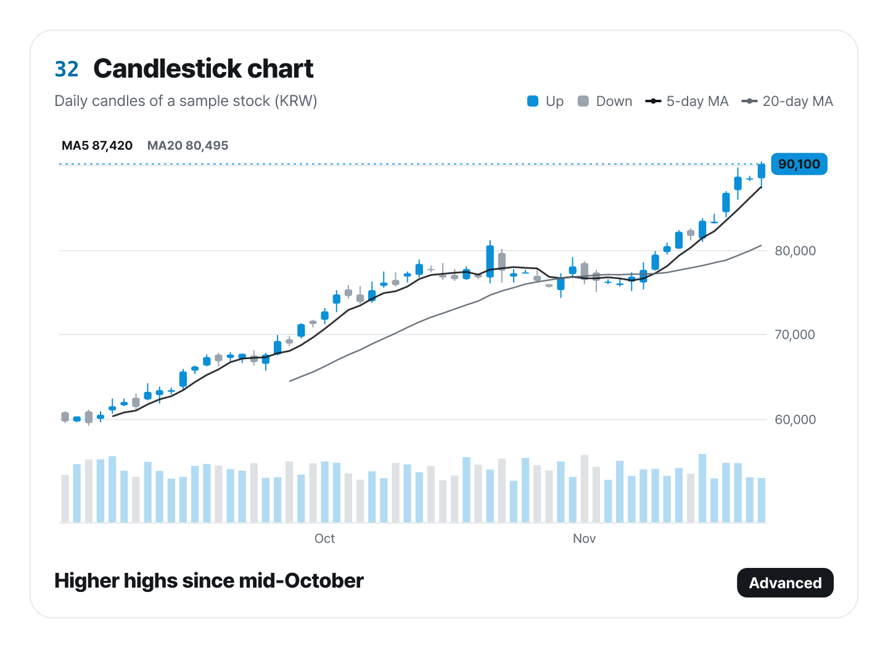

# ztd-charts-cli

`ztd-charts`: the list of all 44 charts, JSON Schema, spec validation, SVG/PNG/HTML rendering, starter files, and chart suggestions from your data.

[Website](https://charts.ztd.app) · [Gallery](https://charts.ztd.app/docs/) · [GitHub](https://github.com/Junhan2/ztd-charts)



The image above came from `npx ztd-charts-cli example candlestick --out spec.json` and then `npx ztd-charts-cli render spec.json --out chart.png --theme light --width 720 --scale 2`.

```bash
npx ztd-charts-cli list
npx ztd-charts-cli info sankey
npx ztd-charts-cli example pie --out spec.json
npx ztd-charts-cli validate spec.json
npx ztd-charts-cli render spec.json --out chart.png --theme light
npx ztd-charts-cli suggest data.csv --out-dir charts
```

Installed in a project (`npm i -D ztd-charts-cli`), the command is `ztd-charts`. Without installing, run it as `npx ztd-charts-cli`: `npx ztd-charts` alone fetches the chart library, which has no command.

Messages, chart text and number formats are English by default. Add `--locale ko` for Korean. `validate` exits with 1 when the spec has errors, so it works in CI.

PNGs are drawn with resvg. Chart text asks for Pretendard first, then Apple SD Gothic Neo, Noto Sans KR or Malgun Gothic. The package ships Pretendard in the five weights charts use (SIL Open Font License 1.1, see `fonts/LICENSE.txt`), so PNG text, Korean included, renders even in a Linux container with no fonts installed. `--font path.otf` or `ZTD_CHARTS_FONT_DIR` loads your own fonts in place of the bundled ones.

To use it from a program: `import { render, validate, suggest, listCharts } from "ztd-charts-cli"`.

Renamed from `@junhanlee/chart-kit-cli` in 0.2.0. The command is now `ztd-charts`, and the font folder variable is `ZTD_CHARTS_FONT_DIR`.
