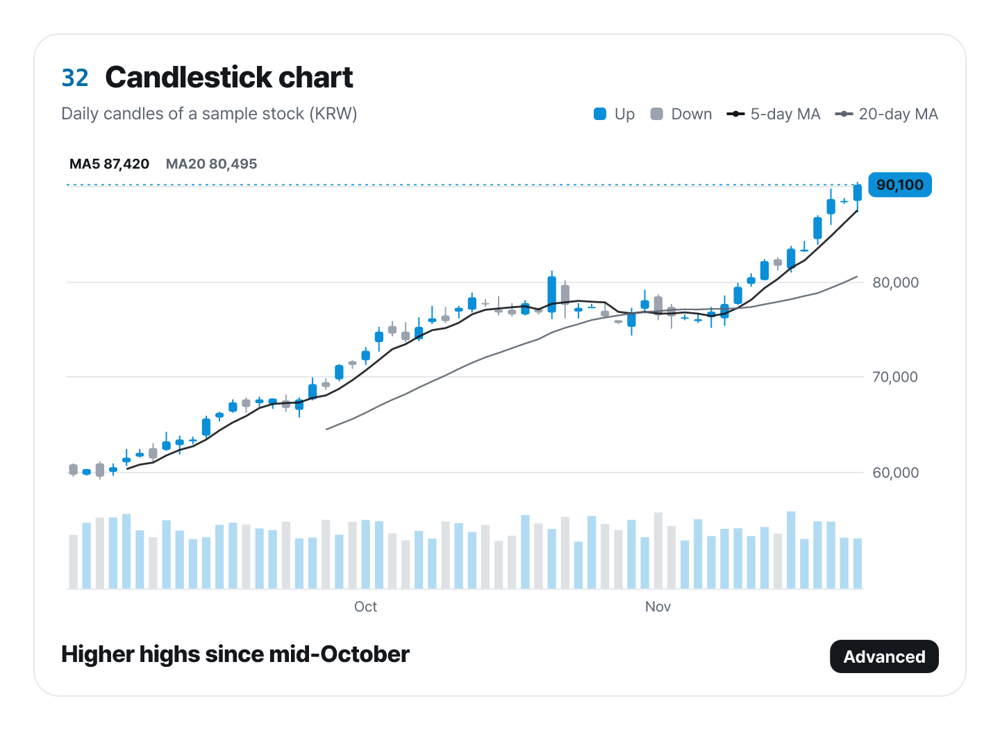

# ztd-charts-mcp

A stdio MCP server for ztd charts, so an AI agent can look up the 33 charts, check a chart spec and render it.

[Website](https://charts.ztd.app) · [Gallery](https://charts.ztd.app/docs/) · [GitHub](https://github.com/Junhan2/ztd-charts)

## Tools

- `list_charts`: the 33 chart types with level, group, a one-line summary, when to use or avoid them, and their encoding channels.
- `get_chart_schema`: the JSON Schema for one chart type, with a complete example spec and a React snippet.
- `validate_spec`: errors and warnings with JSON paths, such as an unknown type, a missing field or a wrong option.
- `render_chart`: a PNG image and SVG of the spec in its card, plus React code ready to paste. Data can be inline rows, CSV text or a URL.
- `suggest_chart`: chart types ranked for your data, each with a reason and a ready spec.

Resource: `ztd-charts://schema/chart-spec.json`. Set `locale: "ko"` for Korean messages and chart text.

Data URLs that point to a private or local network (localhost, 10.x, 192.168.x, 169.254.169.254 and similar) are refused, so an agent cannot read internal services through the server. To load data from a local dev server, add `ZTD_CHARTS_ALLOW_PRIVATE_URLS=1` to the server's environment: `-e` in `claude mcp add`, or the `env` field in a JSON config below.



## Setup

Claude Code:

```bash
claude mcp add ztd-charts -- npx -y ztd-charts-mcp
```

Claude Desktop (`claude_desktop_config.json`), Cursor (`.cursor/mcp.json`) and other clients:

```json
{
  "mcpServers": {
    "ztd-charts": { "command": "npx", "args": ["-y", "ztd-charts-mcp"] }
  }
}
```

Renamed from `@junhanlee/chart-kit-mcp` in 0.2.0. The server name in configs is now `ztd-charts`.
