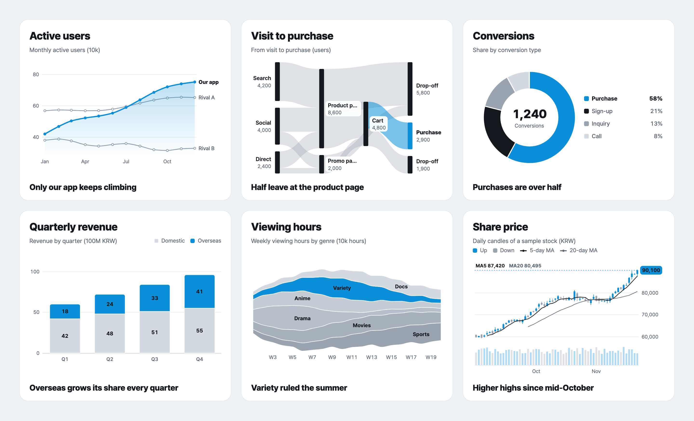
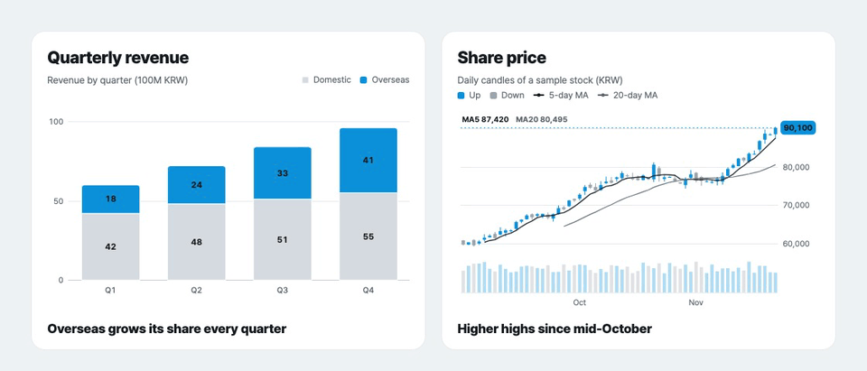

# ztd charts

Animated, accessible React charts that read like a report. 44 charts in pure SVG with no runtime dependencies, and a JSON spec your AI agent can write.

[Website](https://charts.ztd.app) · [Gallery](https://charts.ztd.app/docs/) · [Docs](https://charts.ztd.app/docs/docs/) · [Example dashboards](https://charts.ztd.app/docs/examples/) · [GitHub](https://github.com/Junhan2/ztd-charts) · [한국어](https://github.com/Junhan2/ztd-charts/blob/main/README.ko.md)



## Why ztd charts

- **Each card says one thing.** One item takes the accent color and the rest stay neutral, with a bold takeaway under the chart, so a reader sees the point before reading the axes.
- **Motion that explains.** Charts draw in as they scroll into view, move on from where they are when the data changes, and let you drag over a range to read its change, high and low.
- **Accessible by default.** Keyboard navigation, a screen reader description and data table for every chart, reduced motion, and every label at WCAG AA contrast.
- **Small, with nothing else to install.** React is the only peer dependency. A chart with the shared core is about 12 to 26 kB Brotli, and very large data switches to canvas on its own.
- **Ready for AI.** Every chart is also a JSON spec with a public JSON Schema, and a CLI, an MCP server and an agent skill validate it and render it to PNG, SVG or HTML.
- **English and Korean.** en-US by default. `locale="ko-KR"` switches number formats (1.2만, 3.4억) and chart text to Korean.



## Quick start

```bash
npm i ztd-charts
```

```tsx
import { ChartCard, PieChart } from "ztd-charts";

const sales = [
  { device: "Mobile", share: 72 },
  { device: "Desktop", share: 23 },
  { device: "Tablet", share: 5 },
];

export function SalesByDevice() {
  return (
    <ChartCard title="Sales by device" subtitle="Share of revenue (%)" takeaway="Mobile brings in most sales">
      <PieChart data={sales} label="device" value="share" highlight="Mobile" />
    </ChartCard>
  );
}
```

Every chart page in the [gallery](https://charts.ztd.app/docs/) has the React code, the JSON spec and the CLI command for that chart.

## What's in the package

- `ztd-charts`: 44 chart components (new in 0.8.0: `Choropleth`, `SymbolMap`, `FlowMap`, `Tree`, `Timeline`, `NetworkChart` and `BarRace`), `LiveLineChart`, `ChartCard`, `ChartGrid`, `ChartFacets`, `StatCard`, `ThemeProvider`, `registerMap` and the data helpers.
- `ztd-charts/spec`: the chart registry, JSON Schema, spec validation and chart suggestions, without React. `FACET_TYPES` and `FACET_MAX` say which charts take `facet` and how many panels it draws.
- `ztd-charts/server`: server rendering to SVG and HTML, with every built-in map already registered.
- `ztd-charts/geo/world`, `ztd-charts/geo/us-states` and `ztd-charts/geo/kr-sido`: map boundaries, one entry point per map, so a page that draws no map loads none.
- `ztd-charts/schema.json`: the JSON Schema for chart specs.

Data helpers: `useChartData` loads a URL or an async function and reports loading, error and empty states. `parseCSV`, `fromRows`, `fromObjects` and `melt` reshape tables. `percentiles(rows, { by: "minute", value: "ms" })` turns raw samples into `p50`, `p95` and `p99` rows for a latency chart.

Card and tooltip helpers: `DownloadButtons` adds CSV, SVG and PNG download buttons to a card, and `templateTooltip("{label} · {value} · {owner}")` shows other columns of the row in the tooltip.

Diverging bars: `layout: "diverging"` on `BarChart` stacks the `negative` series left of a zero line and the rest to the right, for Likert surveys, for-and-against splits and population pyramids. `neutral` splits one series across the line, and `percent` shows each segment as a share of its row.

Maps: `Choropleth` shades regions by value, `SymbolMap` puts a circle sized by value at each place, and `FlowMap` draws curved arrows from place to place. `map` defaults to `"auto"`, which picks the registered map that matches the most regions in your data: `world` (ISO codes or country names), `us-states` or `kr-sido`. A map object or your own GeoJSON FeatureCollection works too. In the browser, register the maps you draw:

```tsx
import { Choropleth, registerMap } from "ztd-charts";
import { world } from "ztd-charts/geo/world";

registerMap(world);

const users = [
  { country: "BRA", users: 412 },
  { country: "DEU", users: 268 },
  { country: "IND", users: 530 },
  { country: "USA", users: 655 },
];

export const UsersByCountry = () => <Choropleth data={users} region="country" value="users" />;
```

`ztd-charts/server`, the CLI and the MCP server draw `"map": "world"` with no setup. `focus: "europe"` crops the world map, and `center: "pacific"` on the symbol and flow maps puts the Pacific in the middle, so Shanghai to Los Angeles draws as one line. `FlowMap` reads the same `source`, `target` and `value` rows as `SankeyChart`, with places as region names or `places: { Shanghai: [121.5, 31.2] }`. The boundary data adds about 25 kB Brotli for the world, 11 kB for the US and 5 kB for Korea; its sources and licences are in `NOTICE.md`.

Tile grid map: `TileMap` draws one equal tile per region, shaded by its value, so Rhode Island reads as large as Texas. It ships the 50 US states and DC (`us-states`), Korea's 16 regions from July 2026 (`kr-sido`) and the 17 before the merger (`kr-sido-2025`), picks one from the data with `"auto"`, or takes your own tiles; `resolveGrid`, `tileMatcher`, `tileNeighbor` and `TILE_MAPS` expose the grids and name matching.

More new charts: `Tree` draws a hierarchy as linked dots, horizontal or radial, from nested rows or `id` and `parent` columns. `Timeline` draws one bar per item from `start` to `end`, for schedules, job runs and incidents. `NetworkChart` shows who connects to whom as arcs over one line, from the same rows as the sankey. `BarRace` steps through time with the top bars re-sorting at each step, with play, pause and a frame slider. `stratify`, `networkGraph`, `readTimeline`, `timelineRows` and `formatDuration` expose their layouts and the duration format.

New options: `shape: "arc"` on `WaffleChart` draws a seat chart in half-circle rows, one dot per seat, with `total` for empty seats and `referenceLines` for a majority. `bin: "hex"` on `ScatterChart` counts dense points into hexagons shaded by count, for 100,000 points and more.

Size limits: a spec's `width` and `height` are at most 10,000 px (`MAX_CHART_SIZE` in `ztd-charts/spec`). `validateSpec` rejects more, and server rendering clamps sizes that skip validation, so a spec cannot make a server allocate without limit.

Small multiples: `facet: { by: "region" }` on a line, area, bar or scatter spec draws the same chart once per group on a shared scale, and `<ChartFacets>` does the same in React. Each component has a matching props type (`ChoroplethProps`, `TileMapProps`, `ChartFacetsProps` and so on), and `GeoMap`, `TileDef`, `SpecFacet`, `FacetType` and `FacetScale` are exported too.

ESM with `sideEffects: false`, so only the charts you import end up in your bundle.

## Related packages

- [ztd-charts-cli](https://www.npmjs.com/package/ztd-charts-cli): validate specs and render them to PNG, SVG or HTML from the terminal.
- [ztd-charts-mcp](https://www.npmjs.com/package/ztd-charts-mcp): an MCP server so an AI agent can pick, check and render charts.

## License

MIT. Renamed from `@junhanlee/chart-kit` in 0.2.0: CSS names moved from `--ck-*`, `.ck-*` and `data-ck-theme` to `--ztd-*`, `.ztd-*` and `data-ztd-theme`.
